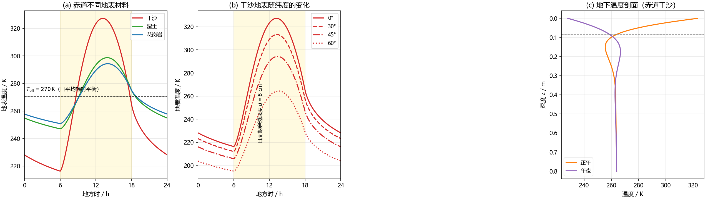

# 忽略大气时地球表面温度的昼夜变化

> **题目**：忽略地球大气，研究地球表面温度随时间的变化，估计温度昼夜波动幅度的数量级。
>
> 本文只讨论**日变化**（周期 $P=24\,\mathrm{h}$ 的分量）。结论先行：赤道附近裸地表的昼夜温差为 **$10^1\sim10^2\ \mathrm{K}$**；干燥、低热导率的地表（如沙）可达 $\sim10^2\ \mathrm{K}$（约 $110\ \mathrm{K}$），致密岩石约 $4\times10^1\ \mathrm{K}$（约 $44\ \mathrm{K}$）。取典型情形，昼夜波动的数量级为 **$10^2\ \mathrm{K}$**。

---

## 0. 结论速览

| 项目 | 数值 |
|---|---|
| 无大气地球赤道处日平均有效温度 | $T_{\rm eff}\approx270\ \mathrm{K}$（全球平均 $255\ \mathrm{K}$） |
| 零热容（瞬时辐射平衡）极限 | 正午 $360\ \mathrm{K}$，夜间 $0\ \mathrm{K}$（不物理） |
| 赤道干燥沙地昼夜温差（本文数值解） | $216\ \mathrm{K}\to327\ \mathrm{K}$，幅度 $\approx110\ \mathrm{K}$ |
| 赤道花岗岩昼夜温差 | $251\ \mathrm{K}\to294\ \mathrm{K}$，幅度 $\approx44\ \mathrm{K}$ |
| 有大气真实地球陆地昼夜温差（对照） | 典型 $10\ \mathrm{K}$，沙漠 $20\sim30\ \mathrm{K}$，海面 $<1\ \mathrm{K}$ |
| 月球昼夜温差（对照，自转 $29.5$ 天） | $100\ \mathrm{K}\to390\ \mathrm{K}$，幅度 $\approx290\ \mathrm{K}$ |

**物理图像**：没有大气，地表白天吸收的太阳能只能靠**地下热传导**储存，夜间再以长波辐射释放。地表的昼夜温差本质上由“一天中多余的能量”与“参与储存的表层热容”之比决定：

$$
\Delta T \;\sim\; \frac{\bar F\,P/2}{\rho c\,d},
\qquad
d=\sqrt{\frac{2\kappa}{\omega}},
\qquad
\kappa=\frac{k}{\rho c}.
$$

其中 $\bar F$ 是日平均吸收的太阳辐射通量，$d$ 是日周期热波的**穿透深度**（几厘米到十几厘米），$\omega=2\pi/P$。对于沙、土、岩石，这个估计给出几十到一百多 K，即 $10^1\sim10^2\ \mathrm{K}$。

---

## 1. 模型与假设

**(1) 几何与太阳辐射.** 取春/秋分（太阳赤纬 $\delta=0$），太阳常数 $S_0=1361\ \mathrm{W\,m^{-2}}$，地表反照率 $\alpha$（地球平均 $\alpha\approx0.3$，月球 $\alpha\approx0.12$）。纬度 $\varphi$ 处、时角 $H=\omega t$（正午 $H=0$）的水平面入射太阳通量为

$$
F_{\rm sun}(t)=
\begin{cases}
(1-\alpha)S_0\cos\varphi\cos H, & |H|<\dfrac{\pi}{2},\\[4pt]
0, & \text{其余（夜间）}.
\end{cases}
$$

**(2) 无大气.** 太阳辐射不被吸收、散射，全部到达地表；地表射出的长波辐射不被温室气体吸收，直接进入太空。因此地表与宇宙空间直接进行辐射交换。

**(3) 地表为半无限大均匀固体.** 只考虑垂直向下的热传导，忽略横向输运（无风、无洋流）、忽略相变潜热、忽略化学反应。发射率取 $\varepsilon=1$（灰体时取常数）。

在上述假设下，问题化为一个经典的**周期性边界条件下的半无限大物体导热问题**。

---

## 2. 地表能量平衡与热传导方程

取 $z$ 轴垂直向下。厚度为 $\mathrm{d}z$ 的地表薄层的能量守恒给出边界条件：

$$
(1-\alpha)S_0\mu(t)\;=\;\varepsilon\sigma T_s^4(t)\;+\;F_c(t),
\qquad
F_c(t)=-k\left.\frac{\partial T}{\partial z}\right|_{z=0}.
\tag{1}
$$

右端第一项是地表向太空的长波辐射，第二项是传入地下的热流（白天向下、夜间向上）。地下温度满足热传导方程

$$
\frac{\partial T}{\partial t}=\kappa\frac{\partial^2 T}{\partial z^2},
\qquad
\kappa=\frac{k}{\rho c},
\tag{2}
$$

$k$ 为导热系数，$\rho c$ 为体积热容。深部边界取零通量（或 $T\to$ 常数）。

对 (1) 式在一个自转周期上取平均，周期态下地下净热流的时间平均为零，因此

$$
\langle T_s^4\rangle=\frac{(1-\alpha)S_0\overline{\mu}}{\varepsilon\sigma},
\qquad
\overline{\mu}(\varphi)=\frac{\cos\varphi}{\pi}.
\tag{3}
$$

定义**日平均有效温度** $T_{\rm eff}=\langle T_s^4\rangle^{1/4}$：赤道 $T_{\rm eff}=270\ \mathrm{K}$；对全球面积平均 $\overline{\mu}=1/4$，得 $T_{\rm eff}=255\ \mathrm{K}$——这就是“无温室效应地球”的著名温度。

---

## 3. 三个层次的估算

### 3.1 零热容极限：为什么必须有“热惯量”

若地表没有任何热容（辐射收支瞬时平衡），由 (1) 式令 $k=0$ 得

$$
T_s(t)=\left[\frac{(1-\alpha)S_0\mu(t)}{\varepsilon\sigma}\right]^{1/4}.
$$

正午 $\mu=1$：$\alpha=0.3$ 时 $T_{\rm noon}=360\ \mathrm{K}$，$\alpha=0.12$ 时 $T_{\rm noon}=381\ \mathrm{K}$；而夜间 $\mu=0$，$T\to0\ \mathrm{K}$。温度在 $0\sim360\ \mathrm{K}$ 之间摆动，显然不物理。**昼夜波动幅度取决于地表把白天能量储存起来的能力，即热惯量。**

### 3.2 热传导：穿透深度与热导纳

设地表温度有周期扰动 $T'(0,t)=\mathrm{Re}\,[\hat T\,e^{i\omega t}]$。方程 (2) 有解

$$
T'(z,t)=\mathrm{Re}\!\left[\hat T\,e^{i\omega t}\,e^{-(1+i)z/d}\right],
\qquad
d=\sqrt{\frac{2\kappa}{\omega}},
\tag{4}
$$

即振幅沿深度指数衰减、相位随深度线性滞后，穿透深度 $d$ 就是振幅衰减到 $1/e$ 的深度。由此得到地表向下热流的复振幅：

$$
\hat F_c=-k\left.\frac{\partial T'}{\partial z}\right|_{0}
=\frac{k(1+i)}{d}\,\hat T
=\sqrt{k\rho c\,\omega}\;e^{i\pi/4}\,\hat T
\equiv \beta\,e^{i\pi/4}\hat T .
\tag{5}
$$

$\beta=\sqrt{k\rho c\,\omega}\ [\mathrm{W\,m^{-2}K^{-1}}]$ 称为地表的**热导纳**：要让地表温度产生相同振幅的振荡，热导纳越大，所需的热流振幅越大，即温度越稳定。第 $n$ 次谐波对应的导纳为 $\beta_n=\sqrt{k\rho c\,n\omega}=\beta\sqrt n$——**高频分量被更强地抑制**，因此地表温度波形比太阳辐照波形更平滑。

代入典型物性参数（$\omega=7.27\times10^{-5}\,\mathrm{s^{-1}}$）：

| 地表材料 | $k\ [\mathrm{W\,m^{-1}K^{-1}}]$ | $\rho c\ [\mathrm{J\,m^{-3}K^{-1}}]$ | $d\ [\mathrm{cm}]$ | $\beta\ [\mathrm{W\,m^{-2}K^{-1}}]$ |
|---|---|---|---|---|
| 花岗岩 | 2.5 | $2.3\times10^6$ | 17.3 | 20.4 |
| 湿土 | 1.5 | $2.5\times10^6$ | 12.8 | 16.5 |
| 干沙 | 0.3 | $1.2\times10^6$ | 8.3 | 5.1 |

### 3.3 线性响应与谐波分析

将长波辐射在 $T_{\rm eff}$ 附近线性化：

$$
\varepsilon\sigma T_s^4\simeq\varepsilon\sigma T_{\rm eff}^4+4\varepsilon\sigma T_{\rm eff}^3\,(T_s-T_{\rm eff}),
$$

即辐射过程对温度扰动相当于一个阻值为 $Y_{\rm rad}=4\varepsilon\sigma T_{\rm eff}^3\approx4.5\ \mathrm{W\,m^{-2}K^{-1}}$ 的阻尼。把太阳强迫按傅里叶展开

$$
F_{\rm sun}(t)=\frac{a_0}{2}+\sum_{n\ge1}a_n\cos nH,
\qquad
\frac{a_0}{2}=\frac{(1-\alpha)S_0\cos\varphi}{\pi},\quad
a_1=\frac{(1-\alpha)S_0\cos\varphi}{2},\quad
a_2=\frac{2(1-\alpha)S_0\cos\varphi}{3\pi},\ \dots
\tag{6}
$$

由 (5) 与线性化后的 (1) 式，第 $n$ 次谐波的温度振幅为

$$
|\hat T_n|=\frac{|a_n|}{\left|\,Y_{\rm rad}+\beta\sqrt n\,e^{i\pi/4}\,\right|},
\qquad
\left|Y_{\rm rad}+\beta e^{i\pi/4}\right|
=\sqrt{\left(Y_{\rm rad}+\frac{\beta}{\sqrt2}\right)^2+\left(\frac{\beta}{\sqrt2}\right)^2}.
\tag{7}
$$

赤道（$\varphi=0$，$\alpha=0.3$）时 $a_1=476\ \mathrm{W\,m^{-2}}$，于是基频振幅

$$
|\hat T_1|\approx
\begin{cases}
476/23.8\approx20.0\ \mathrm{K}, & \text{花岗岩},\\
476/19.9\approx23.9\ \mathrm{K}, & \text{湿土},\\
476/8.9\approx53.6\ \mathrm{K}, & \text{干沙}.
\end{cases}
$$

注意对干沙，$\beta\approx5.1$ 与 $Y_{\rm rad}\approx4.5$ 相当，辐射阻尼不可忽略；对花岗岩，$\beta$ 远大于 $Y_{\rm rad}$，温度波动由地下导热主导。基频相位滞后约 $24^\circ\sim37^\circ$（时间上 $1.5\sim2.5\ \mathrm{h}$），因此最高温度出现在正午后 $2\ \mathrm{h}$ 左右。

### 3.4 最简单的数量级估计：皮肤层储能

把“昼夜波动”只看作能量的存取。白天吸收的**超出日平均**的那部分能量为

$$
E_{\rm day}=\int_{\rm day}\big(F_{\rm sun}-\bar F\big)\,\mathrm{d}t
=\bar F\cdot\frac P2 ,
$$

赤道处 $E_{\rm day}=\dfrac{303\times86400}{2}\approx1.31\times10^7\ \mathrm{J\,m^{-2}}$。这些能量基本储存在厚度为穿透深度 $d$ 的皮肤层里，其面热容为 $\rho c\,d$，故温差尺度为

$$
\Delta T\sim\frac{E_{\rm day}}{\rho c\,d}
\sim
\begin{cases}
1.31\times10^7/(2.3\times10^6\times0.173)\approx33\ \mathrm{K}, & \text{花岗岩},\\[2pt]
1.31\times10^7/(1.2\times10^6\times0.083)\approx132\ \mathrm{K}, & \text{干沙}.
\end{cases}
$$

这与第 3.3 节及后面的数值解都在同一量级：**几十到一百多 K，即 $10^1\sim10^2\ \mathrm{K}$**。

---

## 4. 数值解与结果

### 4.1 数值方法

对 (1)、(2) 两式做隐式（后向欧拉）有限体积离散：

* 网格：$\Delta z=4\ \mathrm{mm}$，深度 $1.2\ \mathrm{m}$（远大于 $d$，底部取零通量）；
* 时间步：$\Delta t=20\ \mathrm{s}$，共积分 25 天；
* 长波辐射项在每步内用 Newton–Picard 迭代线性化，三对角方程组用 `scipy.linalg.solve_banded` 求解；
* 为尽快达到周期稳态，前若干天每昼夜对整层施加一次由能量收支残差给出的均匀温度修正；最后一天的净能量残差 $<1\ \mathrm{W\,m^{-2}}$（约 $0.3\%$），可认为已收敛。

数值结果与第 3.3 节线性理论给出的基频振幅对比如下表（$T_1^{\rm num}$ 为末周期温度序列的傅里叶基频振幅，$T_1^{\rm ana}$ 为 (7) 式）。

### 4.2 结果

赤道及不同纬度、不同地表材料的末周期结果（$\alpha=0.3$，除最后一行）：

| 情形 | $T_{\rm eff}$ / K | $T_{\rm mean}$ / K | $T_{\rm min}$ / K | $T_{\rm max}$ / K | 昼夜幅度 / K | $T_1^{\rm num}$ / K | $T_1^{\rm ana}$ / K |
|---|---|---|---|---|---|---|---|
| 赤道 花岗岩 | 270.4 | 269.2 | 250.8 | 294.4 | **43.5** | 19.9 | 20.0 |
| 赤道 湿土 | 270.5 | 268.7 | 247.0 | 298.7 | **51.7** | 23.7 | 23.9 |
| 赤道 干沙 | 270.6 | 261.7 | 216.3 | 327.3 | **111.0** | 52.8 | 53.6 |
| $30^\circ$N 干沙 | 261.1 | 253.5 | 212.0 | 313.3 | **101.3** | 48.0 | 48.7 |
| $45^\circ$N 干沙 | 248.2 | 242.1 | 205.8 | 294.4 | **88.6** | 41.7 | 42.3 |
| $60^\circ$N 干沙 | 227.6 | 223.6 | 195.0 | 264.4 | **69.4** | 32.4 | 32.8 |
| $45^\circ$N 花岗岩 | 248.0 | 247.3 | 233.7 | 265.7 | **32.0** | 14.6 | 14.6 |
| 赤道 干沙（$\alpha=0.12$） | 286.6 | 275.3 | 223.1 | 350.7 | **127.6** | 61.1 | 62.0 |

**图**：(a) 赤道不同地表材料的温度日变化；(b) 干沙地表的纬度依赖；(c) 赤道干沙地下的温度剖面（虚线为穿透深度 $d=8\ \mathrm{cm}$）。

数值解显示几个物理要点：

1. **温差随热导纳下降而增大**：干沙 $\beta$ 最小，昼夜幅度最大（$111\ \mathrm{K}$）；花岗岩 $\beta$ 最大，幅度最小（$44\ \mathrm{K}$）。实际地表多在两者之间，故 $10^1\sim10^2\ \mathrm{K}$。
2. **温度峰值滞后正午约 $2\ \mathrm{h}$**，最低温出现在日出前，符合热惯量的相位延迟图像。
3. **日变化只影响很薄的一层**：地下 $0.5\ \mathrm{m}$ 以下温度几乎不变（图 c）；日周期热波穿透深度只有 $8\sim17\ \mathrm{cm}$。
4. **平均温度低于有效温度**：如干沙 $T_{\rm mean}=261.7\ \mathrm{K}<T_{\rm eff}=270.6\ \mathrm{K}$。这是因为 $\sigma T^4$ 是凸函数，大幅振荡使 $\langle T^4\rangle$ 抬高于 $T_{\rm mean}^4$；为维持能量平衡，算术平均温度必须被压低（约 $9\ \mathrm{K}$）。
5. **解析与数值吻合**：$T_1$ 的相对偏差在 $3\%$ 以内，说明第 3 节线性响应分析抓住了主要物理。

---

## 5. 讨论

### 5.1 与真实地球、月球的比较

* **真实地球**：大气通过温室效应抬高平均温度（地表平均 $288\ \mathrm{K}$），同时通过湍流热交换、水汽潜热和红外逆辐射强烈抑制昼夜温差。陆地昼夜温差典型约 $10\ \mathrm{K}$，沙漠 $20\sim30\ \mathrm{K}$，海面不足 $1\ \mathrm{K}$。**去掉大气后，陆面昼夜温差增大到约一个数量级以上**（$10^2\ \mathrm{K}$）。
* **月球**：反照率低（$0.12$）、自转慢（$29.5$ 天）、月壤热导率极低，昼夜温差约 $290\ \mathrm{K}$。无大气地球的自转只有 $24\ \mathrm{h}$，夜间冷却时间短得多（12 h vs 14.7 天），因此温差比月球小；但 $24\ \mathrm{h}$ 已足以产生 $10^2\ \mathrm{K}$ 量级的波动。
* 一个直观的对照：本文 $\alpha=0.12$ 的赤道干沙算例给出 $223\to351\ \mathrm{K}$（幅度 $128\ \mathrm{K}$）；若把自转周期改成 $29.5$ 天，结果会趋近月球实测的 $100\to390\ \mathrm{K}$。

### 5.2 纬度、反照率与季节

* 纬度 $\varphi$ 越高，日平均强迫 $\propto\cos\varphi$ 越小，温差单调减小：干沙从赤道的 $111\ \mathrm{K}$（$30^\circ$N 为 $101\ \mathrm{K}$，$60^\circ$N 为 $69\ \mathrm{K}$）。但即使在 $60^\circ$N，温差仍是真实地球的若干倍。
* 反照率越低（吸收越多），温差越大（$\alpha=0.12$ 时达 $128\ \mathrm{K}$）。
* 本计算取春/秋分。在极区冬/夏，太阳可能连续数周不落或不起，此时“昼夜波动”退化为“极昼/极夜的季节波动”，幅度会更大——那是另一个极限。

### 5.3 模型局限

* 忽略了冰/雪形成及升华潜热；真实无大气地球的夜面很可能结霜/结冰，会释放潜热、改变反照率，使结论有所修正。
* 假设地表物性均匀且不随温度变化；实际沙、土、岩石的 $k$ 和 $\rho c$ 随含水量、孔隙率强烈变化。
* 未考虑地形、横向导热与内部地热流（$<0.1\ \mathrm{W\,m^{-2}}$，相对太阳辐射可忽略）。
* 为了简洁，取发射率 $\varepsilon=1$；实际岩石 $\varepsilon\approx0.9$，会略微增大温差。
* 长波辐射的线性化在 $\Delta T\lesssim T_{\rm eff}$ 时成立；干沙的温差已接近这一界限，因此第 3.3 节主要用作数量级估计，精确值由第 4 节数值解给出。

---

## 6. 结论

忽略地球大气后，地表温度完全由**太阳辐射的日变化**与**地下热传导**决定，昼夜温差的数量级为

$$
\boxed{\ \Delta T_{\rm 昼夜}\sim10^{1}\text{--}10^{2}\ \mathrm{K}\ }
$$

取典型干旱地表（干沙），赤道处约为 $110\ \mathrm{K}$（$T_{\min}\approx216\ \mathrm{K}$，$T_{\max}\approx327\ \mathrm{K}$）；致密岩石约 $44\ \mathrm{K}$；纬度升高、反照率增大时幅度减小，但仍在几十 K 量级。这一数值比有大气地球的陆地昼夜温差（约 $10\ \mathrm{K}$）大约一个数量级，而比月球（约 $290\ \mathrm{K}$）小，原因是地球自转快（$P=24\ \mathrm{h}$），夜间来不及深度冷却。决定这一数量级的关键参数是地表的**热惯量** $\beta=\sqrt{k\rho c\,\omega}$（或日周期热波穿透深度 $d=\sqrt{2\kappa/\omega}$）：实际地表这一层只有 $8\sim17\ \mathrm{cm}$ 厚，其面热容决定了白天储存、夜间释放的能量尺度。

---

## 附录 A 主要参数

| 符号 | 含义 | 取值 |
|---|---|---|
| $S_0$ | 太阳常数 | $1361\ \mathrm{W\,m^{-2}}$ |
| $\sigma$ | Stefan–Boltzmann 常数 | $5.670\times10^{-8}\ \mathrm{W\,m^{-2}K^{-4}}$ |
| $P$ | 自转周期 | $86400\ \mathrm{s}$ |
| $\alpha$ | 地表反照率 | $0.3$（月球 $0.12$） |
| $k,\ \rho c$ | 花岗岩 | $2.5\ \mathrm{W\,m^{-1}K^{-1}},\ 2.3\times10^6\ \mathrm{J\,m^{-3}K^{-1}}$ |
| $k,\ \rho c$ | 湿土 | $1.5\ \mathrm{W\,m^{-1}K^{-1}},\ 2.5\times10^6\ \mathrm{J\,m^{-3}K^{-1}}$ |
| $k,\ \rho c$ | 干沙 | $0.3\ \mathrm{W\,m^{-1}K^{-1}},\ 1.2\times10^6\ \mathrm{J\,m^{-3}K^{-1}}$ |

## 附录 B 数值代码

数值计算脚本：`无大气地表温度_数值计算.py`（与本文件同目录）。

核心离散格式（节点 $i=0$ 为地表，$r=\kappa\Delta t/\Delta z^2$，$C=\rho c\,\Delta z/(2\Delta t)$）：

* 地表节点（对 $\sigma T^4$ 在上一迭代值 $T^*$ 处线性化）：
  $$\Big[C+\frac{k}{\Delta z}+4\varepsilon\sigma T^{*3}\Big]T_0-\frac{k}{\Delta z}T_1
  =C\,T_0^{n}+F_{\rm sun}+3\varepsilon\sigma T^{*4};$$
* 内部节点：$-r\,T_{i-1}+(1+2r)T_i-r\,T_{i+1}=T_i^{n}$；
* 底部节点：$T_{N-1}=T_{N-2}$（零通量）。

运行环境：Python 3.12 + NumPy/SciPy/Matplotlib。脚本同时输出本文第 4 节表格数值与图 `fig_无大气地表温度.png`。
